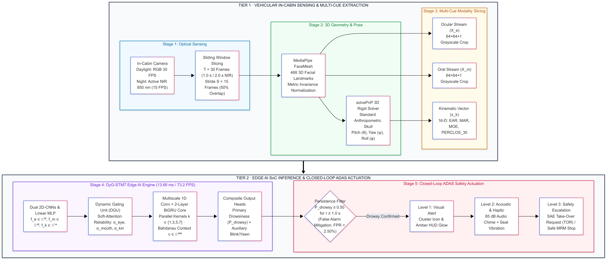
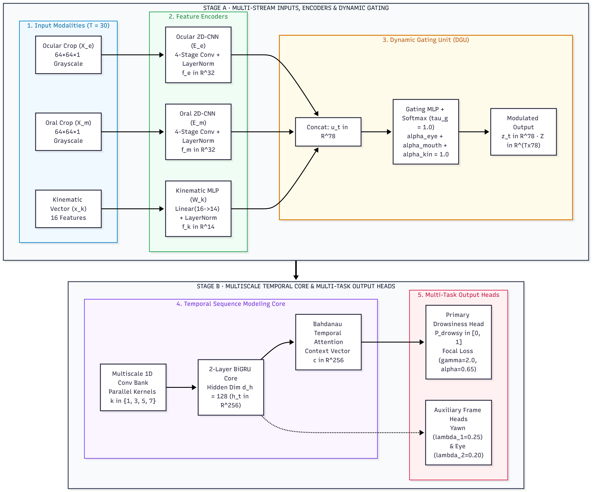
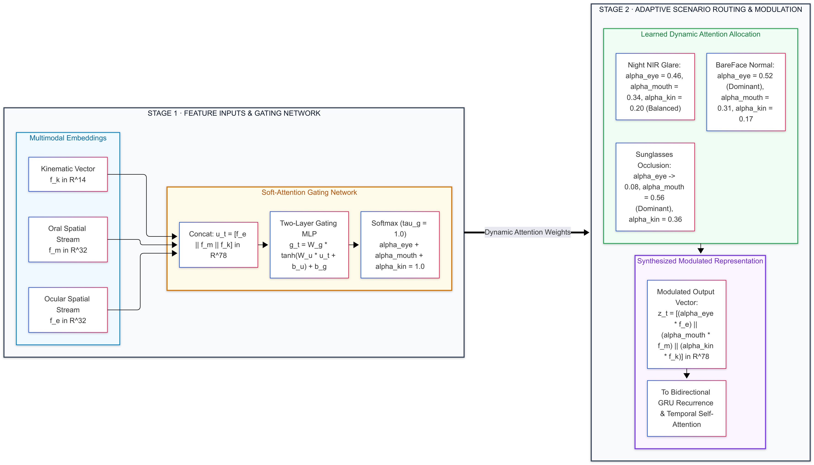

# DyG-STMT: Dynamic Gated Spatio-Temporal Multi-Task Network for In-Cabin Driver Drowsiness Monitoring

[](https://www.python.org/)
[](https://pytorch.org/)
[](LICENSE)
[](https://ascelibrary.org/journal/jtepbs)

Official open-source repository for the research paper:
> **Dynamic Gated Spatio-Temporal Multi-Task Network for In-Cabin Driver Drowsiness Monitoring**  
> *Sonu Kumar, Sakina Salmani, Sujal Meshram, and Shreyas Kotgire*  
> *Department of Computer Science and Engineering, Sardar Patel Institute of Technology, Mumbai, India.*  
> *Target Journal: ASCE Journal of Transportation Engineering, Part A: Systems.*

---

## 📌 Overview

Driver fatigue contributes to thousands of fatal roadway crashes worldwide every year. While in-cabin optical Driver Monitoring Systems (DMS) provide early detection capabilities, traditional facial-cue trackers suffer severe performance degradation under real-world vehicle conditions—particularly when drivers wear **dark tinted sunglasses** or during **nighttime driving with specular reflections and shadows**.

**DyG-STMT** introduces a **Dynamic Gating Unit (DGU)** that adaptively evaluates the visibility and reliability of multiple sensory channels (bilateral ocular crops, labial yawn contours, and 16-D 3D head-pose kinematics). When ocular features are occluded (e.g., by dark sunglasses), the network dynamically suppresses eye-stream weights and reallocates attention to oral yawning and head nodding motions, maintaining high detection fidelity across all operating conditions.



---

## 🚀 Key Highlights

* **Occlusion-Resistant Feature Routing:** The Dynamic Gating Unit (DGU) modulates channel attention in real time, preventing false dismissals when eyes are completely shielded by dark sunglasses.
* **State-of-the-Art Accuracy on NTHU-DDD:**
  * **96.16% Accuracy (0.9905 ROC-AUC)** on strict subject-independent held-out test cohort (14 unseen drivers, 2,450 windows).
  * **97.27% Accuracy (0.9964 ROC-AUC, 97.13% F1)** with the 3-branch multi-scale validation-weighted ensemble.
  * **97.76% Accuracy** specifically under the heavily occluded *Sunglasses* condition.
* **Edge-Deployable Throughput:** 
  * Only **2.55M parameters** (9.72 MB FP32 for ensemble; 0.76M parameters / 2.91 MB for standalone).
  * **13.66 ms** end-to-end processing latency per 30-frame window (**73.2 FPS**), providing ample compute headroom for embedded automotive Electronic Control Units (ECUs) and SoCs (e.g., NVIDIA Jetson Orin Nano, TI TDA4VM, NXP S32G).

---

## 🧠 Architecture Overview



The DyG-STMT pipeline comprises:
1. **Lightweight Facial Extraction:** 468-vertex 3D MediaPipe FaceMesh localization, Perspective-n-Point (PnP) 3D head pose estimation (pitch $\theta$, yaw $\psi$, roll $\phi$), and normalized $64 \times 64$ ocular and oral ROIs.
2. **Dual Spatial CNN Encoders:** Symmetric 4-stage 2D CNN backbones with Layer Normalization yielding 32-D ocular and oral latent representations alongside a 14-D kinematic projection.
3. **Dynamic Gating Unit (DGU):** A learned 2-layer soft-attention gating mechanism with temperature-scaled softmax producing modality weights $\boldsymbol{\alpha}_t = [\alpha_t^e, \alpha_t^m, \alpha_t^k]^T$.
4. **Multiscale Temporal Recurrence:** Parallel 1D temporal filter banks ($k \in \{1, 3, 5, 7\}$) paired with a 2-layer Bidirectional GRU ($d_h = 128$) and Bahdanau temporal self-attention pooling.
5. **Multi-Task Objective:** Joint optimization of window-level Focal Loss ($\gamma = 2.0, \alpha = 0.65$) and auxiliary frame-level yawn and eye-closure binary supervision.



---

## 📊 Benchmark Results

### Performance on NTHU-DDD (14 Held-Out Test Subjects, 2,450 Windows)

| Method / Model | Accuracy (%) | F1-Score (%) | Precision (%) | Recall (%) | ROC-AUC | Latency |
| :--- | :---: | :---: | :---: | :---: | :---: | :---: |
| EAR + MAR Heuristics (Soukupová & Čech, 2016) | 73.40 | 74.80 | 72.10 | 77.70 | -- | < 5 ms |
| 3D-ResNet-18 (Dua et al., 2021) | 89.40 | 90.20 | 88.60 | 91.90 | -- | 38.5 ms |
| Multi-Stage CNN-LSTM (Ahmed et al., 2022) | 91.80 | 92.40 | 91.10 | 93.80 | -- | 26.2 ms |
| Condition-Adaptive 3D-CNN (Yu et al., 2019) | 93.10 | 93.60 | 92.80 | 94.40 | -- | 31.0 ms |
| **DyG-STMT (Primary Standalone)** | **96.16** | **95.99** | **96.10** | **95.88** | **0.9905** | **13.66 ms** |
| DyG-STMT (Multi-Scale Dilated Variant) | 94.73 | 94.42 | 94.80 | 94.04 | 0.9820 | 14.10 ms |
| DyG-STMT (Cross-Attention Variant) | 94.55 | 94.18 | 94.65 | 93.72 | 0.9805 | 14.85 ms |
| **DyG-STMT (Validation-Weighted Ensemble)** | **97.27** | **97.13** | **97.10** | **97.16** | **0.9964** | **22.80 ms** |

### Robustness Across Cockpit Recording Conditions

| Condition | Windows | Standalone Acc | Ensemble Acc | Ensemble F1 | Ensemble AUC |
| :--- | :---: | :---: | :---: | :---: | :---: |
| **BareFace** (Daylight, No Eyewear) | 490 | 97.35% | **98.37%** | 98.26% | 0.9982 |
| **Glasses** (Daylight Prescription) | 490 | 96.12% | **97.14%** | 97.02% | 0.9961 |
| **Sunglasses** (Daylight Heavy Occlusion) | 490 | 96.73% | **97.76%** | 97.64% | 0.9975 |
| **Night-BareFace** (Active NIR, No Eyewear) | 490 | 95.71% | **96.94%** | 96.81% | 0.9958 |
| **Night-Glasses** (Active NIR, Specular Glare) | 490 | 94.90% | **96.12%** | 95.92% | 0.9945 |
| *Gaussian Feature Noise ($\sigma = 0.05$)* | 2,450 | 92.45% | **94.24%** | 93.98% | 0.9854 |

---

## 🛠️ Installation & Setup

### Prerequisites
* Python 3.10 or higher
* CUDA 11.8+ / 12.1+ (optional, for GPU acceleration)
* Standard webcam (for real-time inference)

### 1. Clone the Repository
```bash
git clone https://github.com/Sonu448866/DyG-STMT-Drowsiness-Detection.git
cd DyG-STMT-Drowsiness-Detection
```

### 2. Create Virtual Environment & Install Dependencies
```bash
python -m venv venv
# On Windows:
venv\Scripts\activate
# On Linux/macOS:
source venv/bin/activate

pip install -r requirements.txt
```

---

## 💻 Usage

### 1. Real-Time In-Cabin Inference (Webcam Demo)
To run real-time driver monitoring using your default webcam (Index 0):
```bash
python realtime_inference.py --camera 0 --model-version v4
```
* Press `q` to terminate the inference feed.
* Real-time telemetry will display driver fatigue probability, gating weights ($\alpha_{\text{eye}}, \alpha_{\text{mouth}}, \alpha_{\text{kin}}$), and alert escalation levels.

### 2. Model Evaluation
To evaluate the pre-trained checkpoints across test cohorts:
```bash
python evaluate.py --model-version v4
```

To run the multi-branch ensemble evaluation:
```bash
python ensemble_evaluation.py
```

### 3. Model Training
To train DyG-STMT on extracted NTHU-DDD features:
```bash
python train_v4.py --epochs 30 --batch-size 32 --lr 1e-4
```

---

## 📁 Repository Structure

```
DyG-STMT-Drowsiness-Detection/
├── assets/                       # Architectural diagrams and visualization figures
│   ├── figure1_system_flow.png
│   ├── figure2_model_architecture.png
│   ├── figure3_confusion_matrix.png
│   ├── figure4_dynamic_gating_logic.png
│   └── figure5_ensemble_results_workflow.png
├── models/                       # PyTorch model definitions
│   ├── __init__.py
│   ├── dyg_stmt.py               # Base DyG-STMT architecture
│   ├── dyg_stmt_v2.py            # Multiscale variant
│   ├── dyg_stmt_v3.py            # Cross-attention variant
│   └── dyg_stmt_v4.py            # Final SOTA DyG-STMT architecture
├── utils/                        # Loss functions and evaluation metrics
│   ├── __init__.py
│   ├── losses.py                 # Focal and multitask losses
│   ├── metrics.py                # ROC-AUC, PR, F1 calculation utilities
│   └── v4_losses.py              # Composite regularized loss formulation
├── realtime_inference.py         # Real-time webcam/video deployment script
├── train_v4.py                   # Model training and validation routine
├── evaluate.py                   # Standalone benchmark evaluation script
├── ensemble_evaluation.py        # Multi-branch ensemble fusion evaluation
├── preprocess_dataset.py         # 468 MediaPipe FaceMesh & crop extractor
├── precompute_features.py        # Feature precomputation pipeline
├── requirements.txt              # Environment dependencies
├── LICENSE                       # MIT License
└── README.md                     # Project documentation
```

---

## 📖 Citation

If you find this work or code useful in your research, please cite our manuscript:

```bibtex
@article{kumar2026dygstmt,
  title   = {Dynamic Gated Spatio-Temporal Multi-Task Network for In-Cabin Driver Drowsiness Monitoring},
  author  = {Kumar, Sonu and Salmani, Sakina and Meshram, Sujal and Kotgire, Shreyas},
  journal = {Journal of Transportation Engineering, Part A: Systems},
  year    = {2026},
  note    = {Under Review}
}
```

---

## 👥 Authors & Acknowledgments

* **Sonu Kumar** (Corresponding Author) - `sonu.kumar25@spit.ac.in`
* **Sakina Salmani** - `sakina_shaikh@spit.ac.in`
* **Sujal Meshram** - `sujal.meshram25@spit.ac.in`
* **Shreyas Kotgire** - `shreyas.kotgire25@spit.ac.in`

*Department of Computer Science and Engineering, Sardar Patel Institute of Technology, Mumbai 400058, India.*  
*We acknowledge the National Tsing Hua University Computer Vision Lab for providing the NTHU-DDD benchmark repository.*
